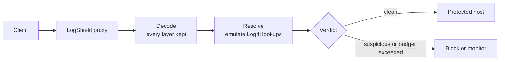

# LogShield

[](https://github.com/TurlaFSB/logshield/actions/workflows/ci.yml)
[](LICENSE)

A virtual-patch reverse proxy for **Log4Shell-class** attacks (CVE-2021-44228 and
related). LogShield sits in front of a host that cannot be patched (end-of-life
OS, vendor-locked appliance, OT/ICS endpoint) and blocks exploit attempts at the
network layer. It is a **compensating control**, not a fix.

> **Status: pre-alpha.** Step 1 (inspection engine) is in progress. Nothing here
> is ready for production use yet. See [docs/ROADMAP.md](docs/ROADMAP.md).

## Why this exists

When Log4Shell was disclosed, Log4j was everywhere and often could not be
updated: vendors were slow to confirm exposure, and many embedded and OT/ICS
hosts cannot be patched at all. Where the host cannot be hardened, the network
in front of it can be. A targeted virtual patch buys time and reduces exposure
while the real fix (patching, removing `JndiLookup`, or retiring the host) is
planned.

## How it works



Decoding, resolution, rules and verdicts are implemented (Steps 1b to 1d; see
[rules](docs/engine/rules.md)), with a measured
[evaluation](docs/eval/report.md) against attack and benign corpora (Step 1e). The
proxy is next. See the [threat model](docs/threat-model.md) for what this
does and does not protect against.

## Design goals

- **Deobfuscation, not string matching.** Log4j resolves nested lookups such as
  `${${lower:j}ndi:...}` at runtime, so naive `jndi:` filters are bypassed. The
  engine decodes the request and statically evaluates nested lookups before
  deciding.
- **Safe by construction.** The engine is a pure, bounded, linear-time library.
  Exceeding any decoding budget is a block, never a pass.
- **Measured, not claimed.** Detection rate per bypass class, false-positive rate
  on benign traffic, and latency are measured and reported, and the corpus is
  validated against a real vulnerable Log4j in an isolated lab.
- **Honest about limits.** The threat model and what LogShield cannot see will
  be documented alongside the code.

## Scope and safe use

LogShield is a defensive tool. All test payloads in this repository are inert
strings that point only to reserved, non-routable names. All validation is
performed against systems owned by the author in an isolated lab network. Do not
test against systems you do not own or have written authorization to test.

## Build

Requires Go 1.24 or newer.

```sh
make build        # builds ./bin/logshield
make check        # vet, lint, tests with race detector and coverage floor
make fuzz         # fuzz each target (FUZZTIME=30s by default)
make bench        # benchmarks
```

## Security

To report a vulnerability, see [SECURITY.md](SECURITY.md).

## License

[MIT](LICENSE)
